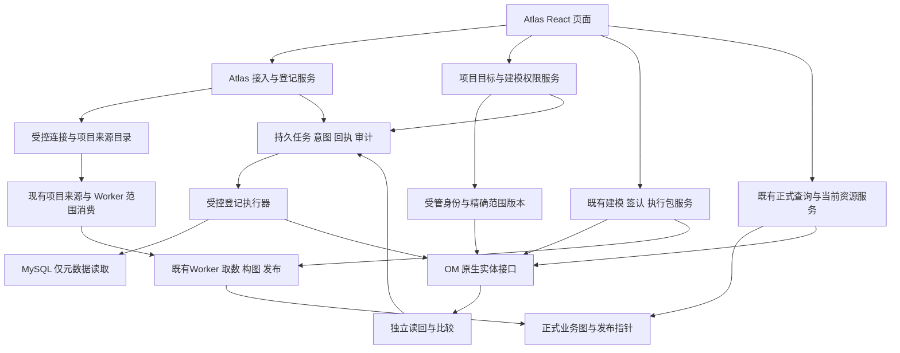

# Atlas 项目初始化 数据接入 本体构建与查询闭环 PRD

版本：v0.2｜日期：2026-10-22（北京时间）｜状态：**M0 已获用户授权并实施中；M1–M9 未放行，业务验收待完成**

配套：[独立验收里程碑](../plans/2026-10-22-atlas-metadata-registration-milestones.md)。本文是现有 Atlas–OM–Semantica PRD 的增量需求，不改写既有阶段状态、权限合同或历史验收。

## 1. 产品目标与本次建议

让管理员和获准用户在 **Atlas 一个产品内**完成“新建项目 → 接入建模身份与权限 → 创建或选择目标本体空间 → 数据源接入与元数据登记 → 项目来源与数据授权 → TBox/Binding 建模 → 试跑与签认 → 执行包发布 → 生产构图与正式事实发布 → 普通用户查询和追溯证据”。日常新增项目、人员和来源不再要求用户打开 OM、调用接口、运行 Python/YAML、搬运原生 UUID/Token，或逐次编辑实例/provider/Worker 配置文件和重启服务。

这里的“登记数据”仍指**登记数据库元数据**：库、表、字段、说明、主键、外键和唯一约束。元数据任务不读取业务行；用户随后在 Atlas 明确发起取数、构图及发布，才进入业务行链路。OM 模型同步与正式事实图发布是两个独立结果，均不能由“元数据已登记”替代。

v0.2 在原数据接入范围上新增两项产品能力：**目标根 Glossary 及 reviewer 初始化**、**建模执行身份/项目范围/原生写权限接入**；并把既有建模、发布、查询链纳入独立节点与最终验收。沿用原文件路径，便于已有引用继续有效。

建议本次一次批准以下产品范围，再按节点实施验收：

| 决策 | 本版建议 |
| --- | --- |
| 首批连接器 | MySQL；包含新连接/新 OM 服务，以及复用已有 OM 服务两条完整路径 |
| 执行方式 | Atlas 管理的后台执行器调用锁定版本的 OM 官方摄取能力或经验证的原生接口；**不依赖 Airflow** |
| 用户入口 | 新项目初始化与就绪页、项目建模权限及目标本体空间；新增“本体管理 → 数据源接入”；衔接既有来源、建模、发布与知识查询页面 |
| 完成边界 | 从没有原生项目目标和建模映射的新 Atlas 项目开始，到普通用户在 Atlas 查询到正式业务实例、关系及来源证据；新建与复用目标两条路径均可验收 |
| 目标初始化 | 默认新建项目独立 Glossary，也可显式选择有权复用的已有目标；在 Atlas 配置有效 reviewer，原生读回后才就绪 |
| 建模身份 | Atlas 内管理精确项目/人员/操作授权，建立受控身份映射与原生权限；实际资源读写使用对应人员 OM_USER，不退回共享管理员 |
| 更新策略 | 首版支持新增资产、复用一致资产和经预检批准的物理约束补全；冲突不自动覆盖。删除、改名、类型破坏性变更及全量同步另期处理 |
| 权限 | 复用现有管理员/普通用户两类产品角色；保留 Atlas 当前许可与对应 OM 用户原生许可的交集，无高权兜底 |

本版“完全在 Atlas 完成”的起点是平台已部署、用户已能登录 Atlas。数据库与合法只读账号/GRANT、网络/TLS、OM/Worker/图存储/验证器、平台秘密存储及受限身份管理能力属于一次性环境前置。**特定新项目、目标 Glossary、reviewer、建模人员映射、项目写权限和来源范围不允许预先由运维补齐来替代产品能力。** 环境故障可升级运维，但不把日常配置或权限不足包装成要求用户去 OM 操作的正常步骤。

## 2. 已核事实与问题定位

### 2.1 昨日演示的真实结果

指定会话 `01a12db4-a744-71d0-87d5-ec2605104b7a` 中，用户明确选择“先只完成 OM 的资产登记，然后记录接口，后续以页面形式做到 Atlas 中”。本次已读该会话及其交付文档，没有重新执行登记脚本或访问业务服务。

根据[操作记录](../../../examples/cross_system_demo_20261021/om-metadata-registration-20261021/README.md)及[独立验收 JSON](../../../examples/cross_system_demo_20261021/om-metadata-registration-20261021/constraints-and-final-readback/verification.json)：

| 项目 | 2026-10-21 的记录结果 | 对本需求的意义 |
| --- | --- | --- |
| 目标 | `docker-mysql.default.atlas_demo_cross_system_20261021` | MySQL 真实库在该连接器中映射为 OM Schema，`default` 是 OM Database 层容器 |
| 登记内容 | 28 表、254 字段、28 单列 PK、26 FK、23 UNIQUE（14 单列、9 复合） | 用作完整回归样本，不把产品限制为这 28 张表 |
| CHECK | 25 个仍在 MySQL；本轮 OM TableConstraint 不支持该类型 | 页面必须显示未覆盖，不伪造原生约束或 SHACL 成功 |
| 执行 | Python 官方摄取框架，无 Airflow；随后对 20 表补全 26 FK | 不是加一个“运行成功”提示即可完成，需要约束和读回环节 |
| 失败与继续 | 首次 sink 实际零写但框架报 100%；后续 11 表已成功后停止，再核对并只续余下 9 表 | 必须按真实结果计数，保留分项进度、原意图与未知状态 |
| 未做 | 未读取/摄取 2,232 条业务行；未改 Atlas provider、Worker scope、项目来源、权限或图谱 | OM 登记成功与 Atlas 后续可用不是同一件事 |

这些是昨日记录的验收事实，不是本次重新运行的结论。其服务、账号及 Pending AutoPilot 任务不能直接作为未来产品的默认身份或任务。

### 2.2 当前 Atlas 的四种容易混淆的能力

| 现有能力 | 源码核到的职责 | 本需求要补的缺口 |
| --- | --- | --- |
| 基础设施“数据源配置” | JDBC 连接 CRUD，供代码生成等功能使用 | 不是 OM 元数据登记；不得因同叫数据源而直接复用其权限或密码返回合同 |
| 项目“来源 → 登记来源” | 从服务端 provider 选择 `connectionId + tableIds`，保存项目来源 | 不能创建 OM 服务、发现未登记物理表或执行摄取 |
| “登记 OM 资源” | 读取已有原生 UUID/版本，批准登记到项目；不授予用户权限 | 不是在 OM 创建数据库/表实体 |
| 模型来源/绑定 | 冻结并引用 TBox、OM 模型或资产，进入既有建模链路 | 不承担前置物理元数据接入 |

后端 provider 当前每次查询读取私有配置文件，并按租户、空间、项目限制连接和表集合；Worker 的 scope 和来源凭据映射则在启动时载入内存。**只完成 OM 写入但仍要求手工补 provider/Worker 配置，不算本需求完成。**具体源码基线见附录 A；其中前端包含当前其他工作的未提交修改，实施前必须重新核对，不能覆盖。

### 2.3 本体构建与查询链的新增缺口

| 当前源码事实 | 本版产品要求 |
| --- | --- |
| 项目/模型页填写现有实例与 Glossary UUID；模型同步先读取目标，并要求 reviewers 非空 | Atlas 可新建或选择目标、配置 reviewer、独立核对并保存绑定；不用手输远端 UUID |
| 模型同步经私有 OmInstanceRegistry 取得精确项目 scope 和 actor→tokenFile；普通用户自动开户及 ViewBasic 授权是另一条链 | 由受控持久配置和身份服务承接建模人员、范围、原生写权限；真实同步消费者动态使用新版本；不是简单开放私有文件编辑 |
| TBox、Binding、试跑、签认、OM 同步、Worker 登记、生产候选、事实发布、查询已有前后端入口 | 优先复用并补齐实际断点；分别做真实接口与页面验收。源码存在不代表新项目已能完整执行 |

Reviewer 是 OM 目标上的原生配置要求，不意味着每次发布都要去 OM 手工审批，也不新增一类 Atlas 产品角色。普通用户开户和资产查看授权可复用，但不能视为建模写权限已具备。附录 E13–E16给出本次核验定位。

## 3. 用户、场景与成功标准

### 3.1 用户职责

- **管理员**：在获准范围新建项目、配置连接和目标、授权建模人员、发起登记、核对异常及开放来源。接入预检可以自提交自确认，保留明确记录；模型/事实发布沿用各自审批合同。
- **项目管理员**：是现有管理员在项目内的职责；配置目标及 reviewer、登记来源、建模、签认并发起发布。需要哪些接入/写权限由当前权限体系核定，不因管理项目自动取得所有物理库、OM 服务或共享模型权限。
- **普通用户**：使用获准的项目来源和资产查询，不创建连接、不查看秘密、不获得 OM 直连入口。

上述是现有角色的职责分工，不新增第三类产品角色。部署/数据库管理员仍负责外部账号和网络准备。

### 3.2 必须覆盖的用户场景

1. **新接入**：已有 MySQL 和合法账号，但 OM 尚无服务/库/表；管理员只在 Atlas 建连接、选表、确认、登记并供项目使用。
2. **复用**：已有 `docker-mysql` 服务，登记一个新库或新增表；原连接、原任务及范围外资产保持。
3. **重复操作**：同一确认请求重复点击或页面刷新，只返回同一任务；再次扫描已有一致资产显示复用，不重复创建。
4. **部分完成**：部分表已登记、部分未知或失败，能看清分项事实并继续原操作的安全剩余部分。
5. **接入衔接**：OM 已验收的表可在 Atlas 开放给项目、被选择登记；不再请人修改私有 JSON 或 Worker 环境文件。
6. **无权限/不支持**：真实显示访问拒绝、未发现范围、CHECK 未支持、外键目标缺失等原因，不通过默认高权或空结果伪装成功。
7. **从零新项目**：项目创建前没有对应 Glossary、actor/scope 配置、来源或发布指针；管理员在 Atlas 完成准备、建模和发布，普通用户在 Atlas 查询业务实例。
8. **新增建模人员**：已有 Atlas 用户仅有元数据查看能力；在 Atlas 获明确建模授权并验证生效后可同步指定项目模型，其他项目和普通读者不因此扩权。
9. **复用或修复目标配置**：在 Atlas 选择有权访问的既有 Glossary、核对 reviewer 与版本，缺项经显式授权补齐；冲突或共享范围无法隔离时阻断，不改不属于本项目的对象。
10. **全链路中断**：身份准备、目标创建、模型同步或事实发布部分完成/UNKNOWN 时，用户在 Atlas 识别停点并核对原任务；不重建项目、换身份或复制 OM 结果来伪造完成。

### 3.3 最终完成标准

- 两条完整路径（新项目/新 Glossary/新服务，以及新项目/复用有权目标与服务）都能通过 Atlas 页面到正式查询；验收者无需 curl、Python、YAML、OM UI、原生 UUID 搬运或逐项目/人员配置文件操作。
- 在隔离的新测试目标重建相同结构后，独立验证 28/254/28PK/26FK/23UNIQUE；25 CHECK 明确未原生登记。不得向昨日已完成对象原样重放脚本。
- 用户选择范围、实际 OM UUID/FQN/字段/约束和登记结果一一可追溯；范围外对象没有被修改。
- 项目来源和执行器使用同一已批准连接/范围版本，新增来源无需重启服务；已有旧来源继续工作。
- 当前用户“能看元数据”“已获数据授权”“可读取业务行”“已生成图谱”分别显示；前一项不能代替后一项。
- 新增建模人员、项目、目标及授权的真实消费者均无须手工改文件或重启；“配置已保存”“权限同步完成”“当前操作已验证”分别显示。
- 使用另行固定的小规模行数据样本，核对 TBox、Binding、执行包、源快照、生产候选、正式发布版本及查询证据的同一条版本链。不是把 OM 表/字段节点当成业务行图。
- 正式查询同时覆盖获准返回、Atlas 拒绝、OM 拒绝、运行中撤权、跨项目/版本旧响应隔离；没有正式版本时明确未发布，不静默改查试跑图。

## 4. 范围与明确不做

### 4.1 首版包含

MySQL 基础表；连接的创建、复用、测试、秘密替换和禁用；物理元数据发现；精确表选择；差异预检与显式确认；持久后台登记；PK/FK/UNIQUE 核对；独立逐表读回与集合核对；受控恢复；任务审计；来源目录、Worker 范围与项目来源衔接；新项目就绪引导；目标 Glossary/reviewer 生命周期；建模身份、精确范围与原生操作授权；既有 TBox/Binding、试跑签认、模型同步/Worker 登记、生产构图、事实发布和正式查询的衔接与必要修复；现有 Aham 8.0 页面适配。

### 4.2 首版不包含

- PostgreSQL、Oracle 等其他连接器，视图/存储过程、DDL 正文、OM Profiler/样本数据摄取、通用数据搬运、CDC、查询日志血缘、自动分类及新增数据质量平台。既有 Worker 经明确发起的业务行快照、构图与校验在本版范围内。
- 定时调度、Airflow 部署/修复、原 AutoPilot 任务接管或重放。
- 自动删除/软删 OM 资产、自动同步源删表、表改名、破坏性字段变更；无“失败后一键整体回滚”。
- 自动创建数据库账号或修改 GRANT；默认扩大普通用户权限；修改 OM 全局默认策略。经管理员明确批准的本项目建模授权属于新增范围，不等于全局扩权。
- 无人确认地生成或接纳 TBox/Binding、业务外键推断、自动越过签认/审批发布图谱，或把源 CHECK 转成 SHACL。Atlas 内手动建模及既有受控导入/生成提案、显式取数和发布在范围内。
- 任意业务标签/全套 OM 治理门户、完整 OWL 语义投影、新查询语言/任意 SQL、专业引擎重写或已有陌生原生账号接管。
- 通用调度平台、新 MQ/Outbox、OM 核心分叉、无关 P1 遗留问题、全局清数据/重建。

后续手动重新扫描仍属于本版，但如发现上述不支持变更，必须生成差异并阻断相应写入，不能要求用户把差异隐藏后继续。

## 5. 信息架构与用户流程

### 5.1 页面分工（新增能力与既有入口衔接）

项目就绪、建模权限、目标初始化和数据接入为拟新增/扩展能力；建模、发布、查询优先复用现有页面，仍需本次真实链路验收。

| 页面 | 用户看到什么 | 主操作 |
| --- | --- | --- |
| 项目新建及就绪页 | 项目、建模身份、目标、来源、模型版本、执行包、事实发布、查询资格各自状态与缺项 | 按当前缺项“完成准备”或进入下一步 |
| 项目 → 建模权限 | 人员、稳定映射、精确项目/目标、操作集合、同步与生效状态 | 配置或撤销建模权限 |
| 项目 → 目标本体空间 | 新建/复用模式、名称/说明、有效 reviewer、当前绑定与版本、影响范围 | 确认初始化或更新配置 |
| 本体管理 → 数据源接入 | 名称、连接类型、目标 OM 服务、可见范围、连接检查、最近登记结果、开放项目数 | 新建接入 |
| 接入详情 | 连接概览、可用目录、登记任务、项目开放范围；秘密只有已配置/待替换状态 | 登记元数据 |
| 登记向导 | ①连接与目标 ②选库选表 ③差异预检与确认 | 当前步下一步；最后一步“确认并登记” |
| 登记任务详情 | 阶段、表明细、真实数量、错误/待核对项、回执、独立验收结果 | 由状态决定：查看结果/只读核对/安全继续 |
| 开放给项目 | 选择已有空间/项目、精确表范围、只读连接引用、是否启用行读取能力 | 确认开放 |
| 原项目来源页 | 已开放的接入及表；可追溯原登记任务和验证时间 | 沿用“登记来源” |
| 原模型工作区及签认发布 | TBox、Binding、试跑报告、签认、执行包、OM 同步和 Worker 登记各自结果 | 沿用当前阶段的保存/校验/提交审核 |
| 原生产与事实发布、知识查询 | 生产运行、候选校验、正式版本、业务实例/关系/来源证据；和当前资源查询分开 | 显式发布或执行获准查询 |

路由名称建议 `/next/ontology/data-sources`，详情及任务作为其子页；最终路由/API 名称由 M0 固化。它不是对现有 `/next/infra/data-source-config` 的改名或整体替换。

项目无可选 provider 时，有接入权限的管理员可点“接入数据源”，保留返回项目上下文；无权限者只显示明确原因和所需管理员职责。不能让普通用户看到跨租户服务名/库名。

### 5.2 正常流程

```mermaid
flowchart LR
  P[Atlas 新建项目] --> U[配置建模身份与权限]
  U --> T[新建或选择目标并配置审核人]
  T --> A[新建或选择数据源接入]
  A --> B[执行节点测试连接]
  B --> C[发现物理元数据并选表]
  C --> D[预检新增 复用 补全 冲突]
  D --> E[明确确认并取得任务号]
  E --> F[后台登记与逐项读回]
  F --> G[约束核对及完整验收]
  G --> H[按权限开放给项目]
  H --> I[项目登记来源]
  I --> J[TBox与Binding 试跑及签认]
  J --> K[执行包审批 OM同步 Worker登记]
  K --> L[显式生产取数 构图 校验]
  L --> M[正式事实审批发布]
  M --> N[获准用户正式查询及证据追溯]
  I --> Q[独立配置普通用户数据授权]
  Q --> N
```

提交后离开表单转任务详情；刷新、关闭标签页不取消后台任务。未提交表单可以放弃；秘密不写 localStorage。已有服务复用不会顺便“修复”其 Pending 采集任务。

上述是推荐用户路径，不强迫已有项目重做成功步骤。就绪页只聚合各子流程真实状态，不建立一笔跨系统“大事务”；用户可以在 Atlas 返回准确停点。元数据登记、模型执行包和事实发布分别确认、分别留下回执，不得触发未纳入本次确认范围的下一业务阶段；执行包审批可按既有合同驱动 OM 同步与 Worker 登记。

## 6. 功能需求

### FR-01 连接和 OM 目标管理

- OM 实例只能从服务端已批准实例选择；源连接填写名称、MySQL 主机/端口、数据库范围、账号及秘密/秘密引用、TLS 配置、执行节点。界面不接收任意 OM Base URL、原生令牌或任意 SQL。
- 两种目标模式：“复用已有服务”必须绑定原实例/服务 UUID；“创建新服务”预检原生创建权限和名称冲突。保存 Atlas 连接草稿不等于创建 OM 服务，原生创建发生在确认后的任务中。
- 源库秘密仅经受控后端保存，返回“已配置”和版本，不返回密码、编码密码或可解析的秘密文件路径。替换秘密产生新连接版本，使旧测试/预检失效。
- 管理员主动输入源库秘密及受控提交所需的短暂浏览器处理是明确例外；提交结束即清除秘密输入，失败时可要求重输。秘密不得进入URL、浏览器持久存储、响应回显、日志或验收制品；普通用户不能取得这些秘密。
- 新服务的原生连接秘密存储方式必须在 M0 用实际版本验证，复用平台受控秘密存储/原生加密能力；不能把明文写进日志、YAML 制品或仓库。已有服务复用不得隐式覆盖原连接。
- 连接禁用阻断新使用，保留历史任务、OM 资产及项目引用；引用存在时显示影响并明确确认，不能级联删除 OM 对象。

### FR-02 从真实执行位置做前置检查

- 检查实际执行节点到 MySQL 和 OM 的网络/TLS、身份、元数据可见权限，以及锁定版本的兼容性。浏览器或 Web 后端可连接不代表后台执行节点可连接。
- 分别显示连接成功、可发现范围、原生登记权限、来源读取准备情况；不得把 `SELECT 1` 成功等同全部表/字段可见。
- MySQL 映射由适配器返回并在确认页展示：如 `物理库 demo → OM Database default → OM Schema demo`，不让用户手输 FQN 猜映射。
- 主机地址采用受控目标策略，阻断越权内网/云元数据地址及任意重定向；允许经批准的真实内网数据库。错误提示给出类别和可操作原因，不回显秘密。
- 单纯测试连接/发现不得写 OM、改数据库或读取业务行。未通过时不能确认登记。

### FR-03 发现与精确选择

- 从元数据接口读取库、基础表、字段序号/类型/可空/说明、PK/FK/UNIQUE 和可观察的 CHECK；过滤系统库，分页/搜索只作用于当前合法可见范围。
- 默认未选表；“全选”明确是本页还是全部匹配项，服务端冻结最终精确表名单，不能把未来新增表自动纳入已批准任务。
- 明示“当前账号可发现的表”，不把账号看不到的表当成源库不存在；预期名单与发现名单不一致时显示缺项。
- 外键引用未选表时：若目标已在同实例 OM 中且当前可合法核对，可引用但不改它；否则列出缺失依赖，用户可显式扩大选择并重新预检，禁止后台偷偷登记额外表。
- 保留源快照摘要、采集时间及连接版本；扫描期间结构变化不能拼成一个未经说明的稳定快照。

### FR-04 精确预检和确认

每次产生不可变 `planId`：绑定发起人、租户/范围、OM 实例/服务、连接/秘密引用版本、物理元数据指纹、所选表、原生 UUID/版本/基线、动作集合、规范化版本及过期时间。建议有效期15分钟；执行前仍重核身份、源结构和目标基线。

用户修改前序连接、目标或选表时，旧发现结果和计划立即失效；返回旧页面、浏览器重发旧请求或切换项目都不能继续旧批准。

| 结果 | 页面含义 | 可执行行为 |
| --- | --- | --- |
| 新增 | 原生实体不存在，创建路径已验证 | 创建必要 database/schema/table，逐项核对 |
| 复用 | 同一合法目标，受支持内容一致 | 不产生无意义写入 |
| 约束补全 | 有物理依据且仅需批准的增量约束 | 带基线前置条件补全，保留非本次内容 |
| 冲突/不支持 | 名称占用、UUID/归属冲突、字段/说明/类型漂移、未支持变更等 | 不覆盖；展示差异及重新预检入口 |

确认页展示精确新增/复用/修改/阻断数、修改字段、外键依赖、CHECK 等限制及范围外不改的边界。存在阻断时不能用“忽略全部”执行；可明确缩小为无冲突子集，形成新的确认计划，原被排除项仍记录。

不把“overrideMetadata=false”“storeServiceConnection=false”单独当成防覆盖保证。写前竞态、原生 create-only/条件 PATCH 能力须实际验证；若 bulk upsert 无法保护已有对象，就改用经验证的创建/更新适配路径，不能为了保留批量接口牺牲边界。

### FR-05 持久登记任务

- 确认只提交已冻结计划及幂等请求标识；相同标识+相同内容返回同一任务，异内容拒绝。用户不在浏览器运行采集器。
- 后台使用受控版本、固定连接器与结构化参数；不接收用户脚本、任意 YAML、shell 或动态安装依赖。
- 顺序为服务（仅新建模式）→ Database → Schema → Table → 约束 → 独立验收。每项写前保存意图和基线，写后保存回执及独立读回。
- 若采用 bulk，解析每项成功/失败而非仅看 HTTP200；每个实体保留原操作身份。框架百分比只作运行诊断，不能作为成功依据。
- Atlas 后台异步任务与 OM bulk 的 async 参数是两层机制。界面等待持久任务进展；采用同步 OM 请求也不阻塞整个页面，更不能把请求返回当作最终验收。
- 每次派发和状态交付前核对当前授权、连接版本和任务所有权。租约只防陈旧本地回执，不宣称可以撤回已经发出的 OM 请求。
- 同一原生目标的重叠任务受控串行；无关项目/目标可继续，不新建全局锁。
- 源只读元数据；禁 profiler/sample/行扫描、源 DML/DDL、自动标删和强制覆盖。原服务及原 Pending 调度任务不受本次接管。

### FR-06 物理约束补全与语义比较

- 以本轮可追溯物理元数据为依据，核对 PK、FK、单列及复合 UNIQUE。优先消费连接器已有结果，补缺时只写明确差额。
- 补全前读原 UUID/版本和完整约束基线，保留原 UNIQUE 及其他非本次约束；有并发漂移则停止该表，不能整数组盲覆盖。
- FK 的本地列与引用列必须按配对顺序比较；不得分别排序以“消除差异”。引用表/字段必须存在且实例/范围合法。
- 仅对当前版本已验证的差异允许规范化：说明文本 HTML 实体解码后的文本比较；UNIQUE 列集排序比较。保留双方原值和比较规则版本，不扩展为 HTML 执行、任意忽略大小写或所有数组排序。
- CHECK 等未支持能力显示“源存在 N 项，OM 原生未登记”，不计入成功登记数，不自动转换为其他语义规则。

### FR-07 独立验收与完成语义

- 由独立读回路径逐表读取实体详情及约束，核对 UUID、FQN、字段及受支持属性、PK/FK/UNIQUE、说明；不能只复用 sink 的内存对象。
- 列表遍历全部分页，核对选中精确集合。新建且原本空的隔离 Schema 可断言恰28表；已有 Schema 可能有其他表，应核选中集合和范围外前后保护，不能错误要求“Schema总表数=本次选择数”。
- OM 搜索暂未索引与原生实体不存在分开显示；不能因为搜索为空再次创建。权限不明/404来源不明也不能直接当作可创建。
- 分别计数计划、已发出、已 ACK、基础读回通过、完整验收通过、失败、待核对、未执行。原ACK缺失但后来读回确认生效的项只增加读回确认数，不回填ACK数。主表以每表唯一状态计数，不能把不同层级数量相加当总表数。
- 只有所有选中表在支持范围内读回一致、前置实体确认且无 UNKNOWN/冲突，任务才为“登记已验收”。CHECK 排除必须随结果呈现。
- 项目就绪摘要分别显示：项目、建模身份/范围、原生写资格、目标/reviewer、元数据登记、项目来源、用户授权、模型/执行包、业务行读取、正式事实发布、查询验证。未做的明确标未配置/未验证/未执行；原调度未部署单列。

### FR-08 部分成功、UNKNOWN 与安全继续

| 情况 | 必须行为 |
| --- | --- |
| 任务尚未首次领取 | 可按权限取消；与领取使用同一事务判定 |
| 首次领取后，包括等待重试 | 不提供人工取消；关闭页面不取消任务。异常或失权可在内部停止后续派发，保留已发效果 |
| 已确认成功 | 继续时跳过，不重发同一写；历史回执保留 |
| 明确未发出/未执行 | 当前授权和完整基线仍有效时，可继续原意图的剩余项 |
| 超时/失联/回执丢失 | UNKNOWN，默认动作“核对结果”；不自动当普通失败，不开放“全部重试” |
| 核对确认已生效 | 追加独立核对证据并关联原意图；保留原ACK缺失事实，标识“读回确认已生效”，只继续剩余安全项 |
| 仍可能有原请求执行，或结果与归属不明 | 保持 UNKNOWN，隔离重叠目标并转人工；一次404不是可重放证明 |
| 源/目标基线或内容变化 | 保留原任务，派生新计划重新预检确认；不能沿用旧批准写新内容 |

普通临时读失败可有界退避；写重试必须满足上述条件。每项默认自动读回最多3次（参数在M0固化），耗尽后等待明确人工核对，不无限循环。不得换任务ID、FQN或服务来绕过未知状态。

### FR-09 来源目录与执行器配置产品化

- 新增持久、服务端所有的接入目录，记录实际 OM 实例/服务/数据库/Schema/表 UUID、物理库映射、连接引用、可开放范围、验证状态和版本。
- 昨日流程中手工 provider 和 Worker scope 的必要配置转成受控管理能力：管理员在 Atlas 选范围并确认，后端持久化并让消费者读取同一版本。日常新增来源不改私有文件、不编辑环境变量、不重启。
- 既有文件型 provider 保持兼容；M0 明确新旧来源唯一性和优先级。相同连接标识或原生目标冲突应拒绝/显式绑定，禁止静默覆盖或把两套范围做更宽的并集。
- Worker 在受控任务领取时取得精确当前范围和必要秘密解析能力，拒绝浏览器伪造的表/库/credentialRef；不把数据库秘密直接写进公开任务制品。
- 元数据连接与业务行读取连接是不同能力。可共用同一秘密引用的条件须显式批准且满足最小权限；不能由元数据成功推断 Worker 已有行读取资格。
- 若只做元数据，目录可保持“元数据已验收／行读取未启用”；选择启用行读取时须验证已预置只读账号和 Worker 配置。测试只读资格与真正执行取数任务分开，登记不顺便抓取业务行。

### FR-10 项目来源与授权衔接

- 管理员选择现有空间/项目及精确表集合，生成该项目可选 provider；不得默认向所有项目开放。产品权限不足时不展示其他项目名或表名。
- 在原项目“登记来源”中选择已开放接入、来源名称及表集合，沿用现有 `connectionId + tableIds` 和版本/权限检查；重复相同登记返回既有引用，不制造第二来源。
- 现有“数据授权”“登记 OM 资源”“当前资源查询”按各自职责继续。来源登记不自动给普通用户授权；如当前流程仍要求手输已知原生UUID，应支持从本次已验收资产选择并带入，保留原核对/批准步骤，避免新的人工搬运接口结果。
- 元数据已验收但项目开放/来源登记失败，显示各自状态，只恢复失败步骤，不再次摄取 OM。
- 将已验收来源送入原 TBox/Binding、Worker 取数、图谱候选和发布入口，继续按 FR-16/17 完成闭环验收；登记来源本身不自动执行这些步骤。

### FR-11 权限与执行身份

- Atlas-only 的接入配置、任务、项目开放操作按现有 Atlas 权限/范围执行；涉及 OM 资源的访问必须满足当前 Atlas 允许 AND 对应 OM 用户对该资源/操作允许。
- 新增元数据写入优先使用发起管理员的稳定映射 OM_USER 及原生创建/编辑权限。新资源的权限按已验证的原生创建权限/父资源规则判定，不能用“资源尚不存在”绕过授权。
- M0 必须证明 SDK/原生接口在此身份下的调用集合和权限可行；若某调用依赖更高权、bot 或无法安全限制的服务能力，先报告差额并评审，不内置管理员/reader回退，也不复制昨日管理员登录脚本。
- 后台凭据和短期会话仅在服务端；普通用户无 OM 密码、JWT/refresh、原生直连通道。源数据库元数据账号、业务行只读账号与 OM 身份分开标识。
- 提交、执行派发、恢复和结果返回都核当前权限。失权阻断新派发及不再允许的结果；已发请求仍需保留真实效果和 UNKNOWN，不能报已撤销。
- 正反验收固定为 Atlas允许+OM允许、Atlas拒绝、OM拒绝、运行中撤权、跨租户/项目伪造、秘密泄漏和旧响应隔离；不扩为 OM 全权限闭包等值校验。
- 身份管理能力只用于受管账号/Team/Role/Policy 的配置与同步，不代用户读取资产、创建目标或写入模型；实际资源写必须使用已获明确授权的对应人员 OM_USER。建模授权与普通 ViewBasic 授权分开呈现，新增建模操作集合按 FR-14 管理，不能简单扩大原查看授权的枚举来跳过原生权限核验。

### FR-12 结果、审计与 Aham 8.0 交互

- 审计包含发起人、范围、计划/连接版本、确认时间、任务/分项ID、请求摘要、目标UUID、ACK、读回、规范化差异和恢复原因；管理员可查看脱敏详情/导出摘要。秘密、原生Token、业务行不进入日志/导出。
- 表级结果有名称、动作、阶段、字段/约束计数、最后核对时间和错误；可筛选失败、待核对、未执行。点击进入完整差异，不能只显示被截断的错误。
- 一页一个主操作；向导编辑态主操作在固定页脚，任务详情动作按实际服务端状态提供。后退不提交，不以关闭弹窗代表取消任务；重复点击有忙碌态及服务端幂等。
- 采用当前 React/AntD、Aham8.0 pc浅色：正文13px、表头/默认行36px、普通控件32px、触屏或窄屏44px；长错误自然换行或有全文入口。状态用文字及语义标识，不只颜色。
- 标签上置，必填星号只出现在编辑态；提交时完整校验，显示原因和改法并可定位到错误字段。校验/保存失败保留非秘密输入，秘密按FR-01清除或重输，不以清空整张表单处理失败。
- 复用当前主题/Portal所有权，不能重挂Provider/owner清空草稿。仅后台已实现并确认的草稿才能显示“已保存”；秘密输入失败后可要求重输，不能伪装为仍已保存。
- 支持Tab/Enter、可见焦点、合理初焦和关闭回焦；IME组字不触发提交，Escape仅关闭最上层浮层，不能连带关闭父编辑或取消后台任务。危险确认默认安全项；原生200%缩放时固定页脚与错误字段仍可达。多步向导属于产品适配，不宣称上游已有完整采集向导实现。

### FR-13 新项目与全链路就绪引导

- 沿用 Atlas 新建项目入口，在获准空间创建本地项目。此时允许没有远端目标、来源或发布版本；显示“项目已创建，准备未完成”，不伪造远端创建成功，也不因后续失败删除项目。
- 项目就绪页给出缺项、原因、处理权限、下一入口和返回上下文；选择目标/人员/来源均通过当前有权目录，不要求用户去 OM 查 UUID、取 Token 或带回接口结果。成员缺少受管身份时提供 Atlas 内开户/同步与状态入口，不提示自行去 OM 开户。
- 准备记录、目标、身份、来源和任务均绑定 tenant/space/project、发起人及配置版本；跨项目复用需独立授权。未就绪只能阻断依赖该能力的操作，本地草稿仍可保存，不能把“不能发布”变成整项目不可查看。
- 所有新增初始化写使用持久意图、幂等、分项回执、独立读回与当前授权复核；沿用 FR-08 的 UNKNOWN/取消边界。相同内容重提返回原记录，基线变化需新确认；页面离开不取消已领取任务。
- 纯 Atlas 闭环是用户操作承诺，不是要求故障自动消失。不可恢复的环境/原生身份冲突在 Atlas 显示诊断与升级运维途径；该场景未闭合则不得计作验收成功，不能用人工原生写入“救场”。

### FR-14 建模执行身份 范围与原生写权限

- 在项目“建模权限”中选择现有 Atlas 人员、获准 OM 实例、精确项目和目标/创建范围、所需有限操作，展示授权差异后明确确认。普通读者不自动变成建模者；配置权限本身按 Atlas 管理授权核定，用户不能自行赋予高权。
- 复用稳定受管 OM_USER 与 credentialRef 的能力，但须实际适配当前模型同步的私有 OmInstanceRegistry 消费路径。持久保存人员→原生身份、实例、精确 scope、凭据引用版本和权限配置版本；对实际 planner/runtime 验证新项目、新人员即时生效，不手改 actor→tokenFile、不重启。具体身份服务复用方案由 M0 固化，不能把它写成当前已实现事实。
- 分开显示“映射已建立”“原生权限同步状态”“当前操作资格”。资格矩阵至少涵盖目标新建/读取/reviewer 更新、Term 创建/更新、必要关系类型、ChangeSet/租约/apply、验证与读回；实际原生操作名称、资源粒度和父资源创建规则必须按锁定版本验证，不凭 Atlas 角色或非空 reviewer 推定写权限。
- 身份管理通道只同步平台所有、具备明确归属的受管身份和项目策略；不接管同名陌生账号，不改变原生 UUID 绑定，不修改全局默认策略或移除他人授权。已有文件映射作为兼容来源；标识冲突拒绝或按明确批准的迁移合同处理，不能静默覆盖或合并成更宽权限。
- 新建目标尚无 UUID 时，先核验必要的原生父资源创建权限，并把 Atlas 意图限制到确切实例、项目、名称和动作；创建后绑定实际 UUID 并核验目标内权限。原生粒度无法满足所选范围，尤其共享 Glossary 或全局关系类型无法隔离时，阻断该模式并提交方案取舍，不默授全局写权限。
- 凭据轮换、人员禁用、scope/目标变更、撤权均在 Atlas 明确操作并记录。发起、领取后派发、恢复和结果返回重核当前配置/权限；旧令牌、缓存和陈旧结果不能继续放行新动作。原生撤权尚未同步时 Atlas 先拒绝，已发请求只核对真实效果。
- 资格检查默认只读；需要实际写才能验证的能力，只在用户明确确认的隔离验证任务或本来获准的业务操作中验证，显示目标和副作用。不在“检查权限”按钮中暗写测试 Term，不以读成功证明所有写能力。

### FR-15 目标 Glossary 与 reviewer 初始化

- 页面称“目标本体空间（OM Glossary）”，与 MySQL 元数据的 Database/Schema 分开。提供“为本项目新建”（默认）和“选择已有目标”两种模式，后端保存真实 UUID/版本；页面展示可读名称、实例及范围。
- 新建填写名称、说明及该版本要求的初始配置，选择有效 reviewer，预览准确原生创建内容后确认；以持久任务创建并独立读回。只有明确不存在且有创建权才能创建；同名不同归属、权限不明404及搜索未索引不自动认领或重复创建。
- 复用先读目标归属、版本、reviewers 和可操作范围。默认只建立本地绑定，不更改已有 owners/tags/术语/其他项目配置；需要补 reviewer 等内容时展示原值、最小差异、共享影响并另行确认，带基线条件写入。无法保护其他使用方时阻断修改，可在 Atlas 改为创建独立目标。
- Reviewer 候选来自获准、有效的受管原生主体目录；只展示当前版本接受的用户/团队类型，并核验主体存在、状态及实际资格。人员映射未完成则返回 FR-14/开户入口；不得任填 UUID 或用一个非空数组通过检查。
- reviewer、Atlas 执行包审批人、事实发布审批人是不同事实；不新增产品角色，不跳过原有签认/审批。能否选择本人按原生能力和既有审批合同执行，不为消除前置而伪造 reviewer。
- 创建成功、reviewer 已核、写资格已核、项目绑定已核分别记录；全部满足才“目标就绪”。同步前再核当前目标/reviewer/身份版本，删除或失效则阻断新同步并给出 Atlas 内修复入口。更新 reviewer 也需权限、差异确认和独立读回。
- 新建响应丢失、权限配置部分成功或绑定失败不自动删除 Glossary、不换名重建；保留原意图，先核对原生效果，再只补未完成步骤。更换已有发布项目的目标会使相关预检/就绪记录失效，不迁移、删除原术语或把旧发布指针改绑到新目标。

### FR-16 Atlas 内建模 试跑与执行包发布

- 复用现有模型编辑、受控原件导入/生成提案、TBox、Binding 和校验入口；新增/修复仅服务本闭环。所有提案仍需明确接纳，既有专业引擎、草稿、校验和版本规则保持，不把登记表自动变成业务概念。
- Binding 从已验收项目来源选择真实表/字段，绑定当前来源/物理结构版本；保留实际 inspect 成功、主键与关系映射校验。以明确映射确定实体标识和关联，不把物理 FK 自动当作业务关系。
- 用户在 Atlas 显式发起有限试跑：取数、生成候选、规则评估、校验、冲突分析及业务签认；按既有依赖顺序执行。读取合法业务行仅发生在此类有明确范围的任务，模型草稿/连接检查/元数据登记不顺带取数。
- 执行包审批冻结 TBox/Shapes/Binding、来源、规则和必要报告版本；审批后 OM 模型同步与 Worker 登记分别记录、读回。只有两者及当前授权都满足原就绪条件才可用于生产；未同步、未登记、UNKNOWN 或失败不显示可执行。
- 新模型所需的受控查询模板在 Atlas 可选择或按既有能力配置，并与模型/执行包版本核对，Worker 实际消费结果可查。若现有界面缺少这一步，补齐本闭环所需入口；不得把逐模型查询配置文件或手输请求体留给用户，不新增任意SQL/查询语言。
- 类/关系/公理在支持范围内经既有同步链创建或更新，Binding 对应资产关系由冻结策略生成；无需用户逐个去 OM 建词条或手动补表标签。已有原生 owners/reviewers/tags 等非本次内容保护；不支持的 OWL 表达和未完整投影字段明确呈现，TBox/Shapes 仍是约束权威。
- 发布被拒、版本变化、原生冲突或同步丢失回执时，保留草稿与原任务，在 Atlas 定位、修正或只读核对；不让用户修改 OM 作为通过条件，不以换执行身份重试绕过拒绝。

### FR-17 生产构图 正式事实发布与普通用户查询

- 从已就绪执行包在 Atlas 明确发起生产取数、构图和既有必检流程；记录真实 SourceRef、快照、候选、执行包和证据版本。业务行图与 OM 元数据资产图分开命名、展示及计数。
- 正式事实发布沿用独立提交、审批和持久发布任务；发布前核必检报告、冲突处理及当前权限。只有原生图版本读回和正式指针条件切换均确认后才显示“正式事实已发布”，OM 模型同步成功不代替该状态。
- 只读候选、试跑图、未发布图和正式图明确区分。已确认未派发或未切换的拒绝/失败不改变旧正式指针；指针可能已切换而回执丢失时保持 UNKNOWN，不承诺旧指针未变，不主动回退或重发。通过 Atlas 只读核对实际图版本、当前指针和原任务归属后追加结论，不能清图或直接改指针。首发确认无正式版本时显示“尚未发布”，结果仍未知时明确待核对，均不默认回退到试跑或资产图。
- 普通用户在“知识查询 → 正式事实”选项目及获准模板/条件，查询实例、关系和原有路径能力，查看业务属性及源表/主键、快照、模型/Binding、正式版本证据；每个结果能指向同一获准发布链，原生标识可作辅助信息但不能要求用户手工搬运。
- “当前资源”按当前 OM 元数据授权读取；“正式事实”按既有正式查询权限及当前原生来源授权核验。普通用户使用本人身份，不借建模人员或管理通道权限；Atlas 本地草稿/审批/发布决策仍由 Atlas 负责，不误要求全部权限集合相等。
- 两类查询均覆盖允许、Atlas 拒绝、OM 拒绝、运行中撤权、切换项目/发布版本及晚到结果隔离；不泄露未授权实体、关系、统计或证据。已有不支持场景如实标限制，不新增任意 SQL 或未经控制的查询接口。
- 最终验收同时证明当前资源查询与正式业务查询。示范链采用隔离且固定的有限业务样本，先锁定预期实例/关系/查询结果再运行；不自动把昨日 2,232 行全部纳入取数或发布范围。

## 7. 核心对象及状态合同

这是需求数据模型，不预定数据库 DDL 或最终 API 命名。

| 对象 | 核心事实 | 不应包含 |
| --- | --- | --- |
| 接入定义 | tenant、连接ID/版本、类型、受控目标、执行节点、secretRef、OM实例/服务绑定 | 明文密码、任意执行代码 |
| 发现快照 | 源版本指纹、可见范围、元数据、精确选择、限制 | 业务行、全库可见性的无根据声明 |
| 登记计划 | 不可变planId、动作和前后基线、确认人/时间、过期、比较规则版本 | 可在提交后静默改变的表集合 |
| 登记任务/分项 | 业务意图ID、attempt/lease、阶段、真实回执、读回、错误、UNKNOWN | 只有日志百分比没有实体事实的成功状态 |
| 项目开放记录 | 接入版本、tenant/space/project、精确原生表集合、元数据/行读取能力 | 泛化通配权限、对全租户默认开放 |
| 项目就绪摘要 | 各独立对象/任务状态及版本、缺项、下一入口 | 以一个成功布尔值代替全链路事实 |
| 建模授权与身份绑定 | 人员、稳定OM_USER、实例、精确scope/目标/操作、credentialRef及配置版本、同步/当前资格 | 公开tokenFile、共享管理员回退、默认全部写权 |
| 目标初始化记录 | 新建/复用模式、意图、原生UUID/版本、reviewer资格及读回、项目绑定 | 同名自动认领、非空reviewer即合格 |
| 既有模型到查询版本链 | 草稿/Binding/试跑签认、执行包、OM同步、Worker登记、源快照、候选、正式发布、查询证据 | 把元数据登记或OM同步等同正式业务图发布 |

任务状态建议：`READY → RUNNING → VERIFYING → SUCCEEDED`；分支为 `PARTIAL / FAILED / UNKNOWN / BLOCKED / CANCELLED`。状态名在 M0 与既有任务模型映射；阶段完成和任务完成分别记录。基础表登记已通过但约束尚未验收时，仍是阶段完成，不能显示最终 SUCCEEDED。

同一原意图可产生多次有记录的安全尝试；attempt 变化不改变已成功分项或原请求身份。用户改变业务内容必须新计划；恢复按钮不能暗中成为新内容审批。

各状态只更新自身：身份配置成功不改目标状态；目标创建成功不改 reviewer/写资格状态；模型同步成功不改事实发布状态。全链路就绪是依赖当前版本的派生结果，任何依赖变化即重新核验，历史成功原件保持。

## 8. 技术边界与拟议接口职责

复用现有任务/审计/身份能力的合适部分，但元数据接入不能伪造 modelReleaseId 或触发正式模型发布。是否可直接使用既有任务表、如何增加接入类型，由M0定点技术设计确认；不以复用为由放松原有操作类型/权限校验。

拟议新增/扩展 API 能力为：项目就绪汇总、建模身份/范围/有限权限配置及生效查询、目标目录与创建/绑定、reviewer候选/资格/条件更新、初始化任务核对恢复；以及接入创建/查询/编辑/禁用及受控秘密替换、测试连接、发现快照/分页、准备计划、确认计划生成任务、任务和分项查询、只读核对、安全继续、未领取取消、项目开放和来源创建衔接。新增部分是**待开发能力**；已有建模/发布/查询服务复用并按实际缺口适配。业务写使用明确写方法，不能用GET悄悄创建/授权。

OM 接口以昨日记录的 services、databases、databaseSchemas、tables 及必要权限调用为候选，最终按锁定版本形成精确能力清单。不得将每日在线文档视为本地 SNAPSHOT 的全部行为证明。官方确认可以[在外部运行 MySQL 摄取框架](https://docs.open-metadata.org/v2.0.x/connectors/database/mysql/yaml)，因此不需要为本需求引入 Airflow；本地认证、bulk分项语义、CAS和约束能力仍需M0隔离验证。

## 9. 非功能要求与上线前置

| ID | 要求与验收方式 |
| --- | --- |
| NFR-01 安全 | 目标/凭据受控；除FR-01管理员主动输入/受控提交的短暂处理外，响应DTO、URL、浏览器持久存储、日志和任务/验收制品中秘密泄漏为0；越界与撤权按FR-11拒绝，无高权回退 |
| NFR-02 持久性 | 刷新页面、服务/执行器中断后能找回同一任务与分项；进程退出不抹去ACK/UNKNOWN，不靠内存状态恢复 |
| NFR-03 有界规模 | 建议首版单任务最多1000表/50000列，可配置并在确认前检查；至少用跨页200表样本核完整选择、分页和结果计数。该数为设计容量，不是当前已测能力；M0固化资源/超时上限，不能静默截断 |
| NFR-04 可运维 | 提交只等待任务受理，不等待整个摄取；任务显示最后进展/超时原因/当前处置。元数据、原生调用及只读核对均有可配置超时和有限重试；无永久转圈 |
| NFR-05 兼容与交付 | 保留既有文件型provider、基础设施数据源和旧项目来源；新增能力可关闭入口/派发而保留历史。读回证据与版本关联；开发机验收不等同生产网络隔离 |

一次性部署前置可以由运维完成：数据库只读账号/网络/TLS、受控 OM 实例及必要原生能力、Worker/图存储/验证器、平台身份管理通道及其受限配置权限、锁定执行器和依赖、秘密存储、Atlas 登录与入口权限。验收时记录这些准备；**不得把新项目的 Glossary/reviewer、具体建模人员/scope/写权限、服务/表/来源的手工 OM 调用或配置文件编辑藏进“一次性前置”。** 平台管理通道的准备不等于代项目人员预先授好全部资源权限。

## 10. 风险、限制与优先决策

| 风险 | 处理与停止条件 |
| --- | --- |
| 本地OM 2.0 SNAPSHOT与旧身份适配/SDK版本不同 | M0锁定实际版本及所需接口；不兼容先报告，不直接升级OM或重写核心 |
| 官方连接器报告成功但缺少写入/约束 | 分项ACK与独立实体读回为准；框架100%不通关 |
| 新建服务或bulk需要不符合既有权限合同的身份 | M0明确阻断；评审受控适配，不擅自恢复管理员/reader路线 |
| 物理账号只见部分表 | 标明可见范围；有预期名单时比对缺项；不承诺发现账号无权看到的库 |
| 多人/原生外部修改共享OM实体 | 创建语义、版本和基线前置保护；不支持时阻断该动作；不声称Atlas锁能保护所有外部入口 |
| 登记成功后provider/Worker仍需手工文件 | M6不能验收；必须完成服务端目录与消费适配，不降为操作手册 |
| Glossary可创建但reviewer无效或共享范围不能隔离 | 目标不能就绪；按原生资格/权限检查修复或新建独立目标，不扩大共享授权 |
| 普通开户/ViewBasic被误当建模写权限 | M1.2映射与M1.3原生写资格分开验收；真实planner/runtime必须使用获准人员身份 |
| 新建Glossary、关系类型或ChangeSet只能靠全局高权 | M0.2形成能力/粒度阻断，不用管理员代发掩盖；在保持本目标与权限边界下评审适配方案 |
| 既有页面有入口但模型/Worker/正式发布链存在断点 | M7/M8实测必要路径并修复本闭环阻断；不能把故障标为“已有功能”从验收删除 |
| 平台已有其他改动/待验功能 | 实施前记录实际源版本和未提交文件，独立限定本次路径；不覆盖其他工作，不顺带重测历史全部矩阵 |

本轮请验收：**从新项目到普通用户正式查询的完整边界、Glossary/reviewer 产品化、建模身份及精确写权限产品化、MySQL 新建/复用路径、无 Airflow、来源与 Worker 动态生效、显式建模及两层发布、首版不做破坏性同步。** 细化接口、数据库表和执行参数属于 M0 产物；不得据此改变上述业务边界。

## 11. 验收与后续动作

配套里程碑逐项给出进入条件、可操作页面/接口、正反用例、允许副作用、证据和退出条件。每个节点独立记录“源码核验、隔离样例、真实接口、人工业务验收”，不得用自动测试覆盖最终真人验收。

规划交付时仅交付 PRD 和里程碑，未执行业务变更。随后用户明确要求“开始第一个里程碑的开发”，并指定前端使用 `aham-tob-design`；因此本次只进入 M0，不提前实施 M1–M9。每个节点不通过则在该节点修正，不用后续大联调代替节点验收。配套计划仍为10个里程碑、27个独立验收节点，当前进度及技术/真实接口/人工结论统一记录于[里程碑 §16](../plans/2026-10-22-atlas-metadata-registration-milestones.md#16-m0实施与独立验收记录)。

M0 交付入口：[实施合同与验证材料](../implementations/2026-10-22-atlas-registration-m0/README.md)。机器接口合同是待产品实现的定义；离线检查和公开版本读取均不能代替普通身份的真实原生写能力、后续页面或业务验收。

## 附录 A：需求依据与源码定位

下列是2026-10-22只读检查定位。代码与昨日记录可能继续变化，实施前重核；本文不声明当前运行环境已具备拟新增功能。

| 编号 | 证据 | 用途 |
| --- | --- | --- |
| E01 | [昨日操作记录](../../../examples/cross_system_demo_20261021/om-metadata-registration-20261021/README.md)、[最终验收JSON](../../../examples/cross_system_demo_20261021/om-metadata-registration-20261021/constraints-and-final-readback/verification.json) | 数量、FK补全、失败继续、未改Atlas等事实 |
| E02 | 指定会话 `codex://threads/01a12db4-a744-71d0-87d5-ec2605104b7a`，用户选择“先只完成OM登记并记录接口”的原消息 | 本次页面化需求来源；历史执行授权不等于本次规划即执行 |
| E03 | [OntologyConnections.tsx](/Users/wangmingzhang/atlas-ui-admin-react/apps/console-react/src/features/ontology/OntologyConnections.tsx:21)、[sourceApi.ts](/Users/wangmingzhang/atlas-ui-admin-react/apps/console-react/src/features/ontology/sourceApi.ts:3) | 项目登记是选择provider/tableIds，不是采集 |
| E04 | [OntologyConnectionController.java](/Users/wangmingzhang/atlas-cloud/atlas-module-infra/atlas-module-infra-server/src/main/java/cn/iocoder/atlas/module/infra/ontology/OntologyConnectionController.java:12) | 既有providers/provider-tables/create/metadata接口 |
| E05 | [OmResourceRegistrationModal.tsx](/Users/wangmingzhang/atlas-ui-admin-react/apps/console-react/src/features/ontology/OmResourceRegistrationModal.tsx:59)、[OntologyOmAssetGrants.tsx](/Users/wangmingzhang/atlas-ui-admin-react/apps/console-react/src/features/ontology/OntologyOmAssetGrants.tsx:63) | 既有原生资产登记、授权与接入的区别 |
| E06 | [DataSourcePage.tsx](/Users/wangmingzhang/atlas-ui-admin-react/apps/console-react/src/features/infra/DataSourcePage.tsx:383)、[codegenApi.ts](/Users/wangmingzhang/atlas-ui-admin-react/apps/console-react/src/features/codegen/codegenApi.ts:38) | JDBC/代码生成连接用途 |
| E07 | [既有PRD §11.6/12](2026-09-26-atlas-openmetadata-semantica-prd.md)、[身份决定](/Users/wangmingzhang/atlas-cloud/docs/ontology-p1/identity-transmission-decision.md:13)、[任务取消合同](/Users/wangmingzhang/atlas-cloud/docs/ontology-p1/post-p1-adjustment-development-plan-20261016.md:56) | 权限交集、普通用户不直连、UNKNOWN和取消规则；新增登记任务应用该保守原则是本版设计 |
| E08 | [OM官方外部摄取文档](https://docs.open-metadata.org/v2.0.x/connectors/database/mysql/yaml)，本轮2026-10-22查询 | 外部执行框架可用；不证明本地所有接口兼容 |
| E09 | [aham-tob-design 2.0.0 / upstream8.0.0](/Users/wangmingzhang/.codex/skills/aham-tob-design/SKILL.md) | 新页Aham8.0适配与交互验收，非产品已实现证明 |
| E10 | [OntologyConnectionProviders.java](/Users/wangmingzhang/atlas-cloud/atlas-module-infra/atlas-module-infra-server/src/main/java/cn/iocoder/atlas/module/infra/ontology/OntologyConnectionProviders.java:9)、[OntologyConnectionService.java](/Users/wangmingzhang/atlas-cloud/atlas-module-infra/atlas-module-infra-server/src/main/java/cn/iocoder/atlas/module/infra/ontology/OntologyConnectionService.java:48) | 当前私有文件目录、精确作用域及本地来源登记 |
| E11 | [deployment.py](/Users/wangmingzhang/atlas-cloud/integrations/ontology-worker/src/atlas_ontology_worker/deployment.py:65)、[source_authority.py](/Users/wangmingzhang/atlas-cloud/integrations/ontology-worker/src/atlas_ontology_worker/source_authority.py:91) | Worker启动固定scope与凭据映射，必须一并产品化 |
| E12 | [DataSourceConfigDO.java](/Users/wangmingzhang/atlas-cloud/atlas-module-infra/atlas-module-infra-server/src/main/java/cn/iocoder/atlas/module/infra/dal/dataobject/db/DataSourceConfigDO.java:18)、[OmOrdinarySessionBroker.java](/Users/wangmingzhang/atlas-cloud/atlas-module-infra/atlas-module-infra-server/src/main/java/cn/iocoder/atlas/module/infra/ontology/omidentity/OmOrdinarySessionBroker.java:124) | 既有JDBC数据源的租户边界与本人OM会话，不能互相代替 |
| E13 | [OntologyProjectEditor.tsx](/Users/wangmingzhang/atlas-ui-admin-react/apps/console-react/src/features/ontology/OntologyProjectEditor.tsx:120)、[OmProjectionPlanner.java](/Users/wangmingzhang/atlas-cloud/atlas-module-infra/atlas-module-infra-server/src/main/java/cn/iocoder/atlas/module/infra/ontology/om/OmProjectionPlanner.java:399) | 当前仅填已有目标，原生目标必须存在且reviewers非空；本版新增完整初始化 |
| E14 | [OmNativeProjectionSynchronizer.java](/Users/wangmingzhang/atlas-cloud/atlas-module-infra/atlas-module-infra-server/src/main/java/cn/iocoder/atlas/module/infra/ontology/om/OmNativeProjectionSynchronizer.java:9)、[OmInstanceRegistry.java](/Users/wangmingzhang/atlas-cloud/atlas-module-infra/atlas-module-infra-server/src/main/java/cn/iocoder/atlas/module/infra/ontology/om/OmInstanceRegistry.java:17)、[OntologyOmIdentityService.java](/Users/wangmingzhang/atlas-cloud/atlas-module-infra/atlas-module-infra-server/src/main/java/cn/iocoder/atlas/module/infra/ontology/OntologyOmIdentityService.java:173) | 建模私有scope/actor配置与普通ViewBasic授权分属不同链，不能混称已产品化 |
| E15 | [OntologyGovernance.tsx](/Users/wangmingzhang/atlas-ui-admin-react/apps/console-react/src/features/ontology/OntologyGovernance.tsx:168)、[OmProjectionRuntime.java](/Users/wangmingzhang/atlas-cloud/atlas-module-infra/atlas-module-infra-server/src/main/java/cn/iocoder/atlas/module/infra/ontology/om/OmProjectionRuntime.java:36) | 已有执行包审核、模型投影及读回链；本版需实际验收 |
| E16 | [OntologyProduction.tsx](/Users/wangmingzhang/atlas-ui-admin-react/apps/console-react/src/features/ontology/OntologyProduction.tsx:165)、[OntologyQueryPage.tsx](/Users/wangmingzhang/atlas-ui-admin-react/apps/console-react/src/features/ontology/OntologyQueryPage.tsx:30)、[OntologyFormalService.java](/Users/wangmingzhang/atlas-cloud/atlas-module-infra/atlas-module-infra-server/src/main/java/cn/iocoder/atlas/module/infra/ontology/OntologyFormalService.java:55) | 事实发布与正式查询分别存在，非本轮真实运行通过证明 |
